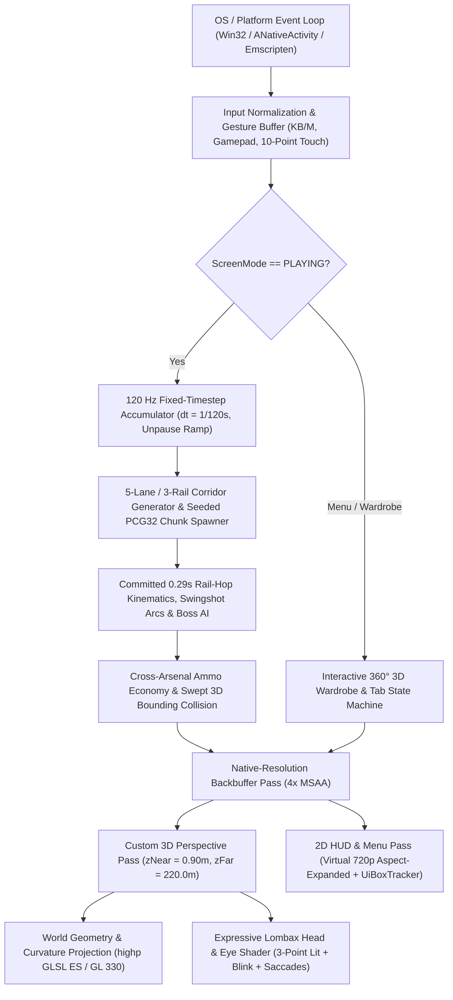
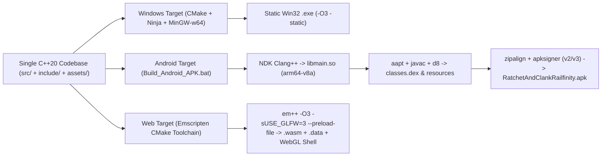

# Ratchet & Clank: Railfinity — Engine & Graphics Architecture

> **Technical Case Study** · C++20 · Raylib 5.0 · OpenGL 3.3 / OpenGL ES 2.0 / WebGL 1.0 · Android NDK (`arm64-v8a`) · Emscripten WebAssembly  
> **Live WebAssembly Build:** [sebiny12p.github.io/Portfolio/play/railfinity](https://sebiny12p.github.io/Portfolio/play/railfinity/) · **Releases:** [v1.0 Windows & Android](https://github.com/sebiny12p/Ratchet_and_Clank_Railfinity/releases/tag/v1.0)

---

## 1. Architectural Overview & Design Goals

*Ratchet & Clank: Railfinity* was engineered from scratch as a single-codebase, tri-platform C++20 3D action engine targeting **Windows (Win32 / OpenGL 3.3)**, **Android (`arm64-v8a` / OpenGL ES 2.0)**, and **Web Browsers (WebAssembly / WebGL)** without relying on heavy commercial engine runtimes or Gradle build daemons.

Core engineering invariants enforced across the codebase:

| Subsystem | Design Target | Concrete Implementation |
| :--- | :--- | :--- |
| **Physics & Simulation** | Frame-rate independent determinism across `60 Hz`–`240 Hz` displays | Fixed-timestep accumulator at `FIXED_DT = 1 / 120 s` (`8.33 ms`) with clamped spiral-of-death guard and `0.75 s` unpause speed ramp |
| **Runtime Memory** | **Zero heap allocations** during active gameplay | Contiguous `std::array<T, N>` pools pre-allocated inside `RailGame` (`hazards_`, `bolts_`, `projectiles_`, `particles_`, `buildings_`) |
| **Procedural RNG** | Bit-identical daily challenges across x86_64, ARM64 & WASM32 | Custom `PCG32` (`XSH-RR`) seeded via `SplitMix64` calendar hash (`YYYYMMDD`) |
| **Mobile 3D Precision** | Zero polygon Z-slicing or submesh z-fighting on tile-based mobile GPUs | Custom `highp` GLSL ES 1.00 world & character shaders + tightened `[0.90m, 220.0m]` perspective frustum |
| **UI & Accessibility** | Crisp typography from `720p` laptops to `2400×1080` phones | Native display-resolution backbuffer (`4x MSAA`), 4-tier DPI-scaled `Roboto` font atlases, and `UiBoxTracker` auto-fit text clamping across 3 accessibility scales (`1.00x`, `1.18x`, `1.35x`) |

---

## 2. Frame Execution & 3D Rendering Pipeline

### Static Memory Pool Budget

All gameplay entities live inside fixed-capacity contiguous arrays inside `RailGame`, eliminating allocator contention, GC pauses, and heap fragmentation during high-speed runs:

| Pool | Type | Capacity | Purpose |
| :--- | :--- | :--- | :--- |
| `hazards_` | `std::array<RailHazard, 96>` | `96` | Crates, Raritanium caches, Gadgetron ammo crates, lasers, drones, shielded Enforcers, sector hazards, and Swingshot nodes |
| `bolts_` | `std::array<FloatingBolt, 256>` | `256` | Rail-hugging hex bolt arcs, titanium bolts, and magnetized crate/dare showers |
| `projectiles_` | `std::array<Projectile3D, 96>` | `96` | Player & Boss ordnance (ricocheting Buzz Blades, chain-EMP Striker beams, homing R.Y.N.O. swarms) |
| `particles_` | `std::array<Particle3D, 512>` | `512` | Grindrail plasma sparks, wrench shockwaves, volcanic embers, and boss explosions |
| `buildings_` | `std::array<SkyBuilding, 48>` | `48` | Deterministic sector skyline architecture recycled along the `Z` horizon |

---

## 3. Solving Mobile GPU Depth-Buffer Slicing (`OpenGL ES 2.0`)

One of the sharpest engineering challenges when bringing the 3D rail renderer to Android (`arm64-v8a` on ARM Mali / Adreno GPUs) was severe **diagonal polygon slicing and submesh Z-fighting** that never appeared on desktop OpenGL 3.3.

### Root Cause Diagnosis
1. **10-Bit `mediump` Vertex Quantization:** Raylib's built-in OpenGL ES 2.0 default shader declares `precision mediump float;`, which maps to IEEE-754 half-precision (`10-bit` mantissa, `~3` decimal digits) on mobile tile-based GPUs. Transforming curved rail geometry and multi-part character meshes through `mvp` in `mediump` quantized clip-space `z/w` coordinates into visible stair-steps.
2. **Near-Plane Hyperbolic Depth Starvation:** A default perspective frustum with `zNear = 0.01` and `zFar = 1000.0` wastes **>90% of a 16-bit mobile depth buffer** in the first `0.10 m` in front of the camera (`[0.01m .. 0.10m]`), leaving almost zero depth-buffer resolution at gameplay distances (`6m .. 140m`).

### Dual Hardware-Level Fix
- **32-Bit `highp` World & Character Shaders:** On OpenGL ES 2.0 / WebGL (`PLATFORM_ANDROID || PLATFORM_WEB`), all vertex positions, `mvp`, `matModel`, and world-space varyings are explicitly promoted to `precision highp float;` (`23-bit` mantissa).
- **Custom Perspective Frustum (`[0.90m .. 220.0m]`):** Replaced standard `BeginMode3D` projection setup with an explicit `rlSetMatrixProjection(MatrixPerspective(fovy, aspect, 0.90, 220.0))` pass. Moving `zNear` from `0.01` to `0.90` improves depth-buffer precision at gameplay distances by **~90×** from frustum geometry alone (and **>250×** combined with `highp` clip-space evaluation), completely eliminating polygon slicing across Ratchet's eyes, muzzle, ears, and distant grindrails.

---

## 4. Real-Time Expressive Character Shader & Android OBJ Material Reconstruction

### Android `AAssetManager` Multi-Material Recovery
On Android, assets live compressed inside the signed `.apk` rather than on a POSIX filesystem. Because standard `tinyobj` material loading relies on relative `chdir` lookups to parse `.mtl` companions, `LoadModel("assets/models/ratchet/ratchet_head.obj")` loads all 6 submeshes on Android but collapses `materialCount` to `1` default material.

`RailGame::Init()` detects collapsed material tables (`materialCount < 5`), reallocates a 5-slot `RL_CALLOC` material array, restores the exact submesh-to-material topology (`{ 0, 1, 2, 3, 4, 2 }`), and binds diffuse maps (`RatHead2Diff`, `RatFur2`, `RatFur`, `EyeDiff`, `RatchetHeadDiff` — dynamically hot-swappable to Rivet's dimensional textures in the Wardrobe Lab) directly via `AAssetManager`-backed texture streams.

### Procedural Facial Animation & Optical Shader (`ratchetHeadShader_`)
To bring a static 3D head mesh to life at zero skeletal-rigging cost across OpenGL 3.3 (`#version 330`) and OpenGL ES 2.0 / WebGL (`#version 100`), `ratchetHeadShader_` combines vertex morphing with procedural optical shading:

1. **Asymmetric Lombax Smirk Morph (Vertex Stage):** Applies a localized 3D Gaussian weight centered on the mouth corners (`|x| ≈ 0.44, y ≈ 0.68, z > 0.72`) with an asymmetric right-cheek bias (`1.08` vs `0.68`) driven by `uFaceParams.z` for Ratchet's signature smirk.
2. **Camera-Relative 3-Point Studio Lighting:** Computes a view-locked key light (`V + (0, 0.72, 0) - 0.45 * right`), warm-to-cool hemisphere fill, and grazing Fresnel rim tint (warm gold for Ratchet, dimensional cyan for Rivet).
3. **Mirrored-UV Eye Saccades:** Both eyes share mirrored UV islands (`uv.x > 0.34, uv.y > 0.37`). Evaluating `dirSign = (vLocalPos.x < 0.0) ? +1.0 : -1.0` shifts both pupils in unison in world space (`uEyeShift`) without UV tearing (`TEXTURE_WRAP_CLAMP`).
4. **Corneal Catchlights, Subsurface Iris Caustics & Parabolic Eyelid Blink:** Renders dual specular catchlights locked to corneal local coordinates, boosts lower-iris caustic glow (`emerald` for Ratchet, `cyan` for Rivet), and sweeps a parabolic upper/lower eyelid mask (`135 ms` natural blink + occasional double-blink) complete with upper-lash crease ambient occlusion.

---

## 5. Curved 5-Lane Corridor & Committed Rail Kinematics

- **World-to-Curve Projection:** Gameplay simulation runs in canonical flat rail coordinates `(lane ∈ [0..4], y, z)` for exact O(1) lane indexing and swept collision checks, while rendering projects every rail segment, bolt, hazard, and boss through `ApplyTrackCurve(laneX, y, z)` — superimposing multi-frequency horizontal/vertical sinusoidal banking bends and camera roll tilt.
- **Dynamic 3-of-5 Active Rail Shifts:** Across a 5-lane spatial matrix (`Lane 0 = +6.4m` to `Lane 4 = -6.4m`), an active 3-rail corridor smoothly shifts laterally downrange, telegraphed by Warp Gate rings and sparks.
- **Committed `0.29s` Rail Hops & Input Buffering:** Switching rails executes a committed parabolic ballistic arc (`0.29 s`) with `140 ms` pre-landing input buffering so rapid multi-lane weaves feel snappy on keyboard, gamepad, and touch swipes without mid-air snap-back jitter.

---

## 6. Tri-Platform Zero-Gradle Build Architecture

By bypassing Gradle in favor of a deterministic 7-stage CLI script (`Build_Android_APK.bat`: `CMake/Ninja NDK` → `aapt R.java` → `javac` → `d8 classes.dex` → `aapt package` → `zipalign` → `apksigner`), clean incremental Android APK builds complete in **under 5 seconds**, matching native desktop and Emscripten WebAssembly iteration speed.
